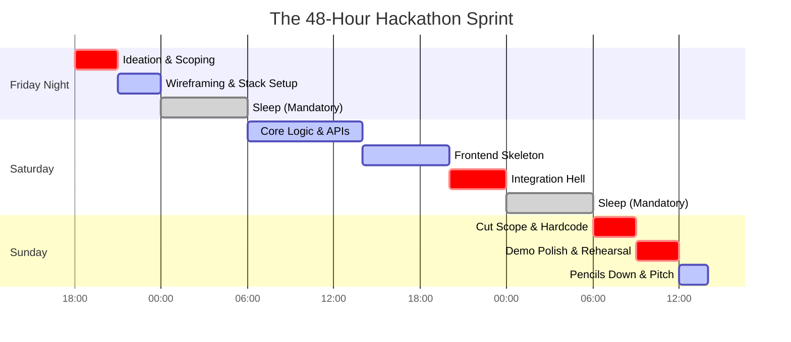

<div align="center">
  

  # 🏆 Hackathon Playbook

  A practical, builder-first guide to learning, building, and competing in hackathons — from your first lines of code to deploying real MVPs.
</div>

<br />

A highly opinionated operating manual for shipping hackathon projects that work. Covers how to find events, dissect problem statements, validate gaps using AI, build core logic in a weekend, and deliver bulletproof pitches without crashing.

No fluff. No theory. Pure engineering pragmatism.

---

## 🧭 Repository & Directory Structure

```
.
├── guides/                     # Core student curriculum & methodologies
│   ├── what-are-hackathons.md
│   ├── finding-hackathons.md
│   ├── research-and-ideation.md
│   ├── building-an-mvp.md
│   └── pitching-and-demos.md
├── resources/                  # Tools, developer platforms & iNSIGHTS AI
│   ├── tools-and-platforms.md
│   ├── learning-resources.md
│   └── insights-ai.md
├── mini-hackathon/             # Turnkey operating manual for hosting events
│   ├── event-overview.md
│   ├── rules-and-guidelines.md
│   ├── timeline.md
│   ├── judging-criteria.md
│   ├── submission-guidelines.md
│   └── organizer-checklist.md
├── templates/                  # Ready-to-use markdown templates & rubrics
│   ├── problem-statement.md
│   ├── mvp-planning.md
│   ├── pitch-deck.md
│   ├── project-readme.md
│   └── judging-scorecard.md
├── docs/                       # Strategy cheat sheets & 40+ project ideas
│   ├── 01-HOW-TO-PICK-AN-IDEA.md
│   ├── 02-TEAM-AND-PLANNING.md
│   ├── 03-JUDGING-AND-PITCHING.md
│   ├── 04-DEMO-PLAYBOOK.md
│   ├── 05-TECH-STACK-CHEATSHEET.md
│   ├── 06-COMMON-MISTAKES.md
│   ├── 07-HOW-TO-STAND-OUT.md
│   └── ideas/                  # Categorized idea repositories
└── public/
    └── banner.png
```

---

## ⚡ The Event Flow & Lifecycle

Whether participating in a fast 6-hour sprint or an intensive 48-hour hackathon, every successful team moves through these five core phases:

```
[ Phase 1 ] ──────► [ Phase 2 ] ──────► [ Phase 3 ] ──────► [ Phase 4 ] ──────► [ Phase 5 ]
Registration &       Research &          MVP Build           Final Code          Evaluation,
Problem Select        Ideation             Sprint            Submission          Demos & Q&A
```

### The 5 Event Phases:

1. **Phase 1: Registration and Problem Selection**
   - Theme unveiling, team confirmation (2–4 members), track selection, and environment setup.
   - Deconstruct user pain points and define target beneficiaries before opening IDEs.
2. **Phase 2: Research and Ideation**
   - Deep search of prior art, competitor analysis, and gap mapping.
   - Accelerate fact-finding with **[iNSIGHTS AI](resources/insights-ai.md)** (Deep Search, Document Intelligence, PredictX).
   - Lock API contracts and draft the single core user flow ("Hero Flow").
3. **Phase 3: MVP Development**
   - Sprint 1: Build database schemas, core algorithms, and backend API endpoints.
   - Mid-sprint reality check: Enforce the *Ruthless Scoping Rule* (cut non-essential features).
   - Sprint 2: Frontend integration, responsive UI assembly, and offline fallback engineering.
4. **Phase 4: Final Submission & Code Freeze**
   - Push code to public GitHub repository, complete the `README.md`, deploy to Vercel/Render, and record a 60-second backup demo video.
5. **Phase 5: Evaluation & Results**
   - 3-minute uninterrupted live product demo followed by 2 minutes of technical judge Q&A.
   - Evaluation across weighted criteria (Problem 25%, Prototype 30%, Innovation 20%, Demo 15%, Learning 10%).

---

### Sprint Timelines

<details open>
<summary><b>⏱️ 6-Hour Express Hackathon Schedule</b></summary>
<br>

| Time Slot | Phase / Activity | Key Deliverables & Milestones |
|---|---|---|
| **10:00 – 10:20 AM** | **Check-in & Briefing** | Table allocation, Wi-Fi credentials, opening rules |
| **10:20 – 10:45 AM** | **Problem Tracks & Rubric** | Judging criteria explained, MVP expectations set |
| **10:45 – 11:15 AM** | **Ideation & Scope Freeze** | Problem selection, research via iNSIGHTS AI, API contract |
| **11:15 AM – 01:00 PM** | **Build Sprint 1 (Engine)** | GitHub repo setup, database schema, core logic running |
| **12:15 – 01:00 PM** | *Mentor Review Round 1* | Feasibility check & scope reduction |
| **01:00 – 01:25 PM** | **Refreshment Break** | Quick lunch, team sync |
| **01:25 – 03:00 PM** | **Build Sprint 2 (UI & Integration)** | Frontend wired to API, test end-to-end user flow |
| **02:15 – 02:45 PM** | *Mentor Review Round 2* | Pitch deck review & backup video check |
| **03:00 PM SHARP** | **CODE FREEZE & SUBMISSION** | Repo pushed, README verified, slides submitted |
| **03:05 – 03:45 PM** | **Live Demos & Presentations** | 3-minute pitch + 2-minute Q&A per team |
| **03:45 – 04:00 PM** | **Scoring & Awards** | Score tabulation, trophies, certificates, group photo |

</details>

<details>
<summary><b>⏱️ 48-Hour Weekend Sprint Timeline (Gantt)</b></summary>
<br>



</details>

---

## 📚 1. Hackathon Guides (`guides/`)

Deep-dive masterclasses covering each stage of the competitor lifecycle:

| File | Guide Title | Core Concepts Covered |
|---|---|---|
| 📄 **[`what-are-hackathons.md`](guides/what-are-hackathons.md)** | **What Are Hackathons?** | Anatomy of a hackathon, formats (software, AI/ML, hardware, social impact), myths vs reality, beginner survival strategies. |
| 📄 **[`finding-hackathons.md`](guides/finding-hackathons.md)** | **Finding & Selecting Hackathons** | Discovery hubs (Devfolio, Unstop, Devpost, MLH), 5-point evaluation filter, ideal team archetypes (Builder, Architect, Storyteller). |
| 📄 **[`research-and-ideation.md`](guides/research-and-ideation.md)** | **Research & Ideation** | Dissecting problem statements, 4-question deconstruction, market gap matrix, research acceleration via iNSIGHTS AI. |
| 📄 **[`building-an-mvp.md`](guides/building-an-mvp.md)** | **Building an MVP Under Time Constraints** | The Ruthless Scoping Rule (Tier 1 vs Tier 2 vs Tier 3), Next.js + FastAPI + Supabase stack, contract-first APIs, preventing integration hell. |
| 📄 **[`pitching-and-demos.md`](guides/pitching-and-demos.md)** | **Pitching, Demos & Post-Hackathon** | 3-minute pitch formula (180s split), defensive live demo rules, handling judge Q&A, translating prototypes into startups. |

---

## 🛠️ 2. Resources & iNSIGHTS AI (`resources/`)

Curated toolkits, learning materials, and AI platform integrations:

| File | Resource Title | Key Capabilities & Highlights |
|---|---|---|
| 📄 **[`tools-and-platforms.md`](resources/tools-and-platforms.md)** | **Tools & Developer Platforms** | UI libraries (shadcn/ui, Tailwind), BaaS (Supabase, Neon, Upstash), AI APIs (Groq, HF), serverless deployment (Vercel, Render), student packs. |
| 📄 **[`learning-resources.md`](resources/learning-resources.md)** | **Learning Resources & Documentation** | Framework tutorials (Next.js, FastAPI, Full Stack Open), open-source reference repos, Git cheat sheet, `.env.example` security checklist. |
| 📄 **[`insights-ai.md`](resources/insights-ai.md)** | **iNSIGHTS AI Platform Guide** | Guide to [insights-ai.info](https://insights-ai.info): **AI Deep Search** (gap finding), **Document Intelligence** (PDF parsing), **PredictX** (trend validation), 6-step hackathon workflow. |

---

## ⚡ 3. Mini Hackathon Operating Manual (`mini-hackathon/`)

The turnkey operating handbook for club leads, student coordinators, and organizers:

| File | Module Title | Description & Operational Purpose |
|---|---|---|
| 📄 **[`event-overview.md`](mini-hackathon/event-overview.md)** | **Event Overview** | Mission, first-year friendly focus, eligibility guidelines, 2–4 member team sizing, track definitions (Campus, Civic, AI). |
| 📄 **[`rules-and-guidelines.md`](mini-hackathon/rules-and-guidelines.md)** | **Rules & Guidelines** | Academic integrity, fresh code policy, permissible open-source boilerplates, responsible AI usage, anti-harassment code of conduct. |
| 📄 **[`timeline.md`](mini-hackathon/timeline.md)** | **Event Timeline & Pacing** | Full 6-hour express schedule, 24-hour weekend schedule, hour-by-hour team pacing checklist. |
| 📄 **[`judging-criteria.md`](mini-hackathon/judging-criteria.md)** | **Judging Criteria & Rubric** | 100-point weighted scoring rubric: Problem Relevance (25%), Working Prototype (30%), Innovation (20%), Live Demo (15%), Learning (10%). |
| 📄 **[`submission-guidelines.md`](mini-hackathon/submission-guidelines.md)** | **Submission Guidelines** | 5 mandatory deliverables (GitHub repo, README, live URL, pitch slides, 60s backup video), self-audit checklist, late submission policy. |
| 📄 **[`organizer-checklist.md`](mini-hackathon/organizer-checklist.md)** | **Organizer Checklist** | End-to-end organizer checklist: T-14 days venue/prize setup, T-24h power/AV testing, day-of-event countdown ops, post-event wrap-up. |

---

## 📋 4. Field Templates (`templates/`)

Standardized markdown templates to copy and paste directly into your workflow:

| File | Template Name | When & How to Use It |
|---|---|---|
| 📄 **[`problem-statement.md`](templates/problem-statement.md)** | **Problem Statement Analysis** | Use during Phase 2 to define the one-sentence problem, user persona, competitor gap matrix, and iNSIGHTS AI research logs. |
| 📄 **[`mvp-planning.md`](templates/mvp-planning.md)** | **MVP Planning & Tech Spec** | Use during Phase 3 to map the single Hero User Flow, Tier 1/2/3 feature priorities, and JSON API request/response contracts. |
| 📄 **[`pitch-deck.md`](templates/pitch-deck.md)** | **7-Slide Pitch Deck Framework** | 7-slide structure optimized for 3-minute pitches (Cover, Problem, Solution, Live Demo, Architecture, Feasibility, Team). |
| 📄 **[`project-readme.md`](templates/project-readme.md)** | **Project README.md Boilerplate** | Ready-to-use GitHub project landing page with status badges, quickstart commands, architecture block, and team credits. |
| 📄 **[`judging-scorecard.md`](templates/judging-scorecard.md)** | **Judging Scorecard** | Official printable and digital evaluation rubric sheet for judges, mentors, and track evaluators. |

---

## 💡 5. Strategy Guides & Idea Bank (`docs/`)

Complementary strategy playbooks and 40+ curated hackathon project blueprints:

<details open>
<summary><b>Click to expand strategy guides & project ideas</b></summary>
<br>

### Core Strategy Guides
| Guide | What it covers |
|---|---|
| [**01: How to Pick an Idea**](guides/research-and-ideation.md) | The Three Filters for choosing a winning idea fast. |
| [**02: Team & Planning**](guides/finding-hackathons.md) | Roles, timeline, and scoping for a 24-48hr build. |
| [**03: Judging & Pitching**](guides/pitching-and-demos.md) | What judges actually score, and how to hack the rubric. |
| [**04: Demo Playbook**](guides/pitching-and-demos.md) | The Critical Path demo scripts, video tips, and defensive fallbacks. |
| [**05: Tech Stack Cheatsheet**](docs/05-TECH-STACK-CHEATSHEET.md) | Fast, reliable stacks by project type (Boring = Better). |
| [**06: Common Mistakes**](docs/06-COMMON-MISTAKES.md) | The common traps that sink otherwise-good projects. |
| [**07: How to Stand Out**](docs/07-HOW-TO-STAND-OUT.md) | Story-driven demos, showing the learning curve, and the LinkedIn test. |

### Idea Bank (40+ Projects)
| Category | Link |
|---|---|
| **Master Index** | [**Browse the full mindmap**](docs/ideas/00-IDEA-INDEX.md) |
| **Memory Agents** | [Sales](docs/ideas/09-memory-agents-sales.md) • [Marketing](docs/ideas/10-memory-agents-marketing.md) • [Engineering](docs/ideas/11-memory-agents-engineering.md) • [Ops](docs/ideas/12-memory-agents-operations.md) • [Product](docs/ideas/13-memory-agents-product.md) |
| **AI & Agents** | [Browse ideas](docs/ideas/02-ai-and-agents.md) |
| **Productivity** | [Browse ideas](docs/ideas/01-productivity-tools.md) |
| **Fintech** | [General](docs/ideas/03-fintech.md) • [AI Finance Projects](docs/ideas/14-ai-finance-projects.md) |
| **Health & Wellness** | [Browse ideas](docs/ideas/04-health-and-wellness.md) |
| **Climate & Impact** | [Browse ideas](docs/ideas/05-sustainability-and-climate.md) |
| **Education** | [Browse ideas](docs/ideas/06-education.md) |
| **Social Good** | [Browse ideas](docs/ideas/07-social-good-and-accessibility.md) |
| **Developer Tools** | [Browse ideas](docs/ideas/08-developer-tools.md) |

</details>

---

## 🎯 Quick Start Scenarios

- **Scenario 1: You have 2 hours until kickoff and no idea what to build.**  
  Read [`01-HOW-TO-PICK-AN-IDEA.md`](guides/research-and-ideation.md) for the framework, run research on [iNSIGHTS AI](resources/insights-ai.md), then steal an idea from the [Idea Index](docs/ideas/00-IDEA-INDEX.md).

- **Scenario 2: You have an idea, but you don't know who should do what.**  
  Read [`finding-hackathons.md`](guides/finding-hackathons.md) and [`02-TEAM-AND-PLANNING.md`](guides/finding-hackathons.md) to assign Builder, Architect, and Demo Driver roles immediately.

- **Scenario 3: You are stuck in "Integration Hell" with 6 hours left.**  
  Read [`building-an-mvp.md`](guides/building-an-mvp.md) and [`06-COMMON-MISTAKES.md`](docs/06-COMMON-MISTAKES.md). Cut scope to Tier 1, hardcode mock endpoints if necessary, and save the live demo.

- **Scenario 4: Your project actually works and you want to win.**  
  Spend your final 3 hours on [`pitching-and-demos.md`](guides/pitching-and-demos.md), [`pitch-deck.md`](templates/pitch-deck.md), and [`04-DEMO-PLAYBOOK.md`](guides/pitching-and-demos.md). Code gets you to the finals; the 3-minute pitch wins the trophy.

---

## 🤝 Contributing

We welcome additions, new project ideas, improved templates, and regional hackathon guides! Check out the repository guidelines to contribute:
- Fork the repo and create a branch: `git checkout -b feat/new-template`
- Ensure all markdown formatting is clean and links are verified.
- Open a Pull Request describing your experience or contribution.

---

<div align="center">
  <b>If this playbook helped you ship and win, give it a ⭐️ on GitHub!</b>
</div>

---

## 📄 License

MIT © [yashkoparde](https://github.com/yashkoparde)
