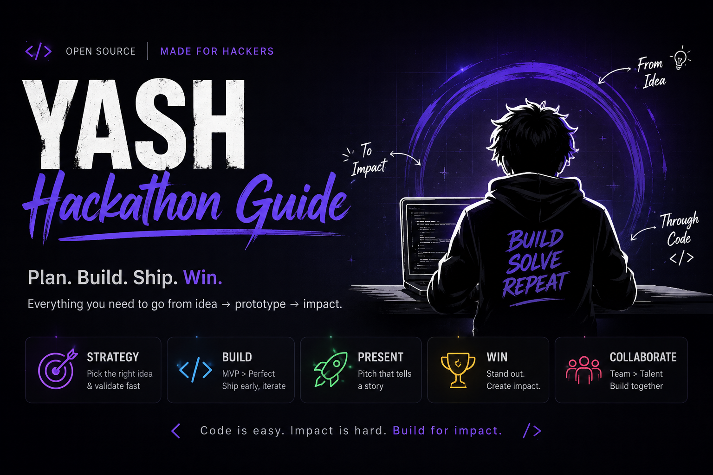
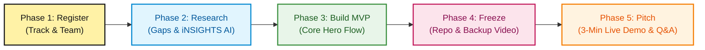
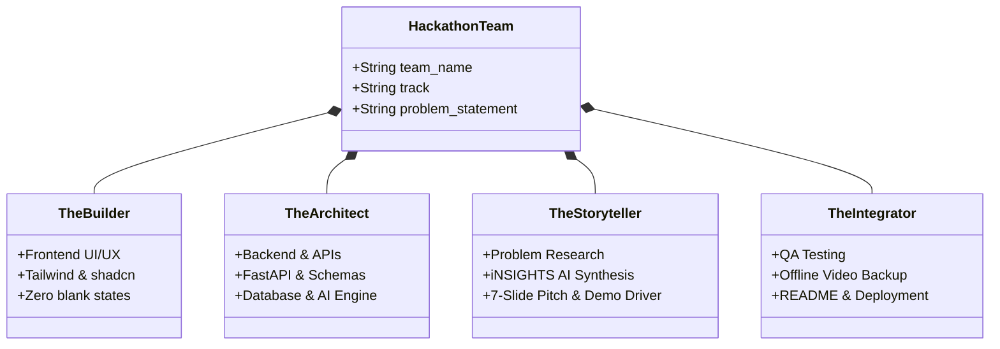

<div align="center">
  

  # Hackathon Playbook

  A practical, builder-first handbook to learning, scoping, building, and pitching winning projects — from first-time developers to seasoned hackathon teams.

  [](mini-hackathon/event-overview.md)
  [](LICENSE)
  [](CONTRIBUTING.md)
</div>

<br />

> [!IMPORTANT]
> **UPCOMING SPRINT: INVICTUS MINI HACKATHON**  
> **Date:** Saturday, 31 October 2026 &nbsp;|&nbsp; **Time:** 10:00 AM – 4:00 PM IST (6-Hour Build Sprint)  
> **Audience:** First-Year & Undergraduate Engineering Builders &nbsp;|&nbsp; **Team Size:** 2–4 Members  
> **Tracks:** Campus Innovation & EdTech • Civic Tech & Regional Impact • Practical AI for Good  
> **Operating Manual:** Read the complete [Event Overview](mini-hackathon/event-overview.md) and [6-Hour Timeline](mini-hackathon/timeline.md).

---

## Repository & File Directory

```
.
├── guides/                     # Core student curriculum & methodologies
│   ├── what-are-hackathons.md  # Anatomy, tracks, myths vs reality & tips
│   ├── finding-hackathons.md   # Discovery platforms, filters & team design
│   ├── research-and-ideation.md# Problem deconstruction, gap analysis & iNSIGHTS AI
│   ├── building-an-mvp.md      # Ruthless scoping, modular stacks & API contracts
│   └── pitching-and-demos.md   # 3-minute pitch formula, demo safety & judge Q&A
├── resources/                  # Toolkits, dev stacks & platform guides
│   ├── tools-and-platforms.md  # Frontend, BaaS, AI APIs, free student tiers
│   ├── learning-resources.md   # Framework tutorials, repos, Git cheat sheet
│   └── insights-ai.md          # iNSIGHTS AI Deep Search, Doc Intel & PredictX
├── mini-hackathon/             # Turnkey operating manual (Event: 31 Oct 2026)
│   ├── event-overview.md       # Objectives, eligibility, tracks & deliverables
│   ├── rules-and-guidelines.md # Original code policy, AI ethics, conduct
│   ├── timeline.md             # 6-Hour Express & 24-Hour Master Timelines
│   ├── judging-criteria.md     # 100-point rubric breakdown & score calibration
│   ├── submission-guidelines.md# Mandatory deliverables & self-audit checklist
│   └── organizer-checklist.md  # Pre-event, venue AV/power, sprint ops & awards
├── templates/                  # Fill-in-the-blank markdown assets & forms
│   ├── problem-statement.md    # Problem Analysis, User Persona & Gap Matrix
│   ├── mvp-planning.md         # Single Hero User Flow, Scope Cuts & API Contracts
│   ├── pitch-deck.md           # 7-Slide Pitch Deck framework (180s split)
│   ├── project-readme.md       # Standard production-ready GitHub README
│   └── judging-scorecard.md    # Printable/Digital evaluator scorecard
├── docs/                       # Strategy cheat sheets & 40+ project ideas
│   ├── 05-TECH-STACK-CHEATSHEET.md
│   ├── 06-COMMON-MISTAKES.md
│   ├── 07-HOW-TO-STAND-OUT.md
│   └── ideas/                  # Categorized idea repositories (Memory Agents, Fintech, AI)
└── public/
    └── banner.png
```

---

## The Hackathon Sprint Pipeline

Every winning hackathon project follows this systematic 5-phase execution flow:



| Phase | Duration | Core Goal | Critical Deliverable |
|---|---|---|---|
| **Phase 1: Registration** | First 45 mins | Align team, select track, confirm table | Team name, track selection & workspace ready |
| **Phase 2: Research** | 45–90 mins | Validate user problem & map competitor gaps | One-sentence problem spec & API contract |
| **Phase 3: MVP Sprint** | Core 3–4 hours | Build and connect single hero user flow | Live functioning prototype with seeded data |
| **Phase 4: Submission** | 30 mins before cutoff | Code freeze, deploy, record backup video | Public GitHub link, README & slide deck |
| **Phase 5: Evaluation** | Final 60 mins | Deliver 180s pitch + 120s judge Q&A | Uninterrupted live demo & score tabulation |

---

## 6-Hour Express Timeline (31 October 2026)

The exact execution timeline for the **Saturday, 31 October 2026** build sprint:

```mermaid
gantt
    title INVICTUS Mini Hackathon: 31 October 2026 (10:00 AM - 4:00 PM)
    dateFormat HH:mm
    axisFormat %H:%M

    section Kickoff
    Check-in & Table Setup     :done, k1, 10:00, 20m
    Tracks, Rules & Rubric Briefing :done, k2, 10:20, 25m

    section Discovery
    Ideation & Scope Freeze (iNSIGHTS AI) :crit, d1, 10:45, 30m

    section Sprint 1
    Core Backend & Engine Build :active, s1, 11:15, 105m
    Mentor Roundtable Check-in 1 :crit, m1, 12:15, 45m

    section Refuel
    Snack & Networking Break   :done, b1, 13:00, 25m

    section Sprint 2
    UI Assembly & API Integration :active, s2, 13:25, 95m
    Mentor Roundtable Check-in 2 :crit, m2, 14:15, 30m
    Code Freeze & Final Submission :crit, sub, 15:00, 5m

    section Showcase
    Live Pitches & Demonstrations (3m + 2m) :active, p1, 15:05, 40m
    Score Tabulation & Award Ceremony :done, a1, 15:45, 15m
```



---

## The Ideal Hackathon Squad

A balanced 3-to-4 person team prevents integration bottlenecks:



---

## 1. Hackathon Guides (`guides/`)

Step-by-step masterclasses designed to take students from beginners to podium finishers:

| Document | Title | Key Takeaways & Visual Models |
|---|---|---|
| **[`what-are-hackathons.md`](guides/what-are-hackathons.md)** | **What Are Hackathons?** | Categorization matrix (Software, AI/ML, Civic, Hardware), 4 common beginner myths debunked, rules of engagement. |
| **[`finding-hackathons.md`](guides/finding-hackathons.md)** | **Finding & Selecting Hackathons** | Platform directory (Devfolio, Unstop, Devpost, MLH), 5-point evaluation filter, squad role division. |
| **[`research-and-ideation.md`](guides/research-and-ideation.md)** | **Research & Ideation Guide** | The 3-Filter Ideation Test (Urgency, Feasibility, Wow-Factor), 2x2 competitor gap matrix, iNSIGHTS AI workflow. |
| **[`building-an-mvp.md`](guides/building-an-mvp.md)** | **Building an MVP Under Time Constraints** | The Ruthless Scoping Rule (Tier 1 vs Tier 2 vs Tier 3), Next.js + FastAPI + Supabase stack, contract-first design. |
| **[`pitching-and-demos.md`](guides/pitching-and-demos.md)** | **Pitching, Demos & Post-Hackathon** | 180-second pitch blueprint, 4 golden rules of live demos, judge Q&A defense playbook, startup incubation steps. |

---

## 2. Resources & iNSIGHTS AI (`resources/`)

Community-tested developer platforms, documentation quickstarts, and AI tools:

| Document | Title | Featured Services & Capabilities |
|---|---|---|
| **[`tools-and-platforms.md`](resources/tools-and-platforms.md)** | **Tools & Developer Platforms** | **UI:** shadcn/ui, Tailwind, Lucide • **Backend:** FastAPI, Supabase, Neon • **AI:** Groq, Hugging Face • **Cloud:** Vercel, Render. |
| **[`learning-resources.md`](resources/learning-resources.md)** | **Learning Resources & Documentation** | Framework tutorials, open-source reference repos, Git terminal workflow cheat sheet, `.env.example` setup. |
| **[`insights-ai.md`](resources/insights-ai.md)** | **iNSIGHTS AI Platform Guide** | Deep dive into [insights-ai.info](https://insights-ai.info): **AI Deep Search** (gap finding), **Document Intelligence** (PDF parsing), **PredictX** (trend models). |

---

## 3. Mini Hackathon Operating Manual (`mini-hackathon/`)

The turnkey operating manual for hosting and competing on **Saturday, 31 October 2026**:

| Document | Module | Operational Focus |
|---|---|---|
| **[`event-overview.md`](mini-hackathon/event-overview.md)** | **Event Overview** | Mission, first-year undergraduate focus, 3 tracks (Campus, Civic, AI), team size (2–4), confirmed date: **31 October 2026**. |
| **[`rules-and-guidelines.md`](mini-hackathon/rules-and-guidelines.md)** | **Rules & Guidelines** | Academic integrity, fresh code policy, allowed boilerplates vs forbidden clones, responsible AI ethics, code of conduct. |
| **[`timeline.md`](mini-hackathon/timeline.md)** | **Event Timeline & Pacing** | Complete 6-hour express schedule for 31 October 2026, 24-hour hackathon timeline, milestone pacing checklist. |
| **[`judging-criteria.md`](mini-hackathon/judging-criteria.md)** | **Judging Criteria & Rubric** | 100-point rubric: Problem Clarity (25%), Working Prototype (30%), Innovation (20%), Live Demo (15%), Learning (10%). |
| **[`submission-guidelines.md`](mini-hackathon/submission-guidelines.md)** | **Submission Guidelines** | 5 mandatory deliverables (GitHub repo, README, live URL, pitch deck, 60s backup video), self-audit checklist, late policy. |
| **[`organizer-checklist.md`](mini-hackathon/organizer-checklist.md)** | **Organizer Checklist** | End-to-end ops: T-14 days venue booking, T-24h power/AV tests, day-of-event countdown management, post-event awards. |

---

## 4. Field Templates (`templates/`)

Ready-to-use markdown templates to copy and paste directly:

| Template | File | Purpose |
|---|---|---|
| **[Problem Statement Analysis](templates/problem-statement.md)** | `templates/problem-statement.md` | Define the acute user problem, target persona, competitor gaps, and iNSIGHTS AI validation queries. |
| **[MVP Planning & Tech Spec](templates/mvp-planning.md)** | `templates/mvp-planning.md` | Map the single Hero User Flow, enforce Tier 1/2/3 scope cuts, and lock JSON API request/response contracts. |
| **[7-Slide Pitch Deck](templates/pitch-deck.md)** | `templates/pitch-deck.md` | 7-slide structure with speaking cues and time allocations for 180-second presentations. |
| **[Project README Boilerplate](templates/project-readme.md)** | `templates/project-readme.md` | Production-ready GitHub landing page template with badges, local setup commands, architecture block, and team credits. |
| **[Judging Scorecard](templates/judging-scorecard.md)** | `templates/judging-scorecard.md` | Official evaluation scorecard with weighted criteria and qualitative feedback fields for evaluators. |

---

## 5. Curated Idea Bank & Strategy (`docs/`)

Explore 40+ hackathon project blueprints across popular domains:

<details open>
<summary><b>Click to expand strategy cheat sheets & idea index</b></summary>
<br>

### Strategy Cheatsheets
-  [**Tech Stack Cheatsheet**](docs/05-TECH-STACK-CHEATSHEET.md) — Fast, reliable stacks by project type (Boring = Better).
-  [**Common Mistakes to Avoid**](docs/06-COMMON-MISTAKES.md) — Traps that sink otherwise good projects.
-  [**How to Stand Out to Judges**](docs/07-HOW-TO-STAND-OUT.md) — Story-driven demos and proving your learning curve.

### 40+ Project Ideas by Category
-  **[Master Idea Index](docs/ideas/00-IDEA-INDEX.md)** — Comprehensive mindmap across all tracks.
-  **Memory Agents:** [Sales](docs/ideas/09-memory-agents-sales.md) • [Marketing](docs/ideas/10-memory-agents-marketing.md) • [Engineering](docs/ideas/11-memory-agents-engineering.md) • [Ops](docs/ideas/12-memory-agents-operations.md) • [Product](docs/ideas/13-memory-agents-product.md)
-  **Specialized Tracks:** [AI & Agents](docs/ideas/02-ai-and-agents.md) • [Productivity](docs/ideas/01-productivity-tools.md) • [Fintech & AI Finance](docs/ideas/14-ai-finance-projects.md) • [Health & Wellness](docs/ideas/04-health-and-wellness.md) • [Climate & Sustainability](docs/ideas/05-sustainability-and-climate.md) • [Education](docs/ideas/06-education.md) • [Social Good](docs/ideas/07-social-good-and-accessibility.md) • [Developer Tools](docs/ideas/08-developer-tools.md)

</details>

---

## Quick Start Scenarios

```
┌─────────────────────────────────────────────────────────────────────────────┐
│ SCENARIO 1: You have 2 hours until kickoff and no idea what to build.       │
│ -> Open guides/research-and-ideation.md, run a search on insights-ai.info,   │
│   and select a validated blueprint from docs/ideas/00-IDEA-INDEX.md.        │
├─────────────────────────────────────────────────────────────────────────────┤
│ SCENARIO 2: You have an idea, but don't know who should do what.            │
│ -> Open guides/finding-hackathons.md and assign roles: Builder, Architect,  │
│   Storyteller, Integrator. Lock schemas using templates/mvp-planning.md.    │
├─────────────────────────────────────────────────────────────────────────────┤
│ SCENARIO 3: You are stuck in "Integration Hell" with 3 hours left.          │
│ -> Open guides/building-an-mvp.md and docs/06-COMMON-MISTAKES.md. Cut scope  │
│   to Tier 1, hardcode mock endpoints for secondary flows, and save demo.   │
├─────────────────────────────────────────────────────────────────────────────┤
│ SCENARIO 4: Your prototype works and you want to win the podium.            │
│ -> Open guides/pitching-and-demos.md and templates/pitch-deck.md. Practice    │
│   the 180s pitch 3 times and record an offline 60-second backup video.      │
└─────────────────────────────────────────────────────────────────────────────┘
```

---

## Contributing

We welcome community contributions! If you have a winning hackathon framework, a tested starter boilerplate, or a novel problem statement template:
1. Fork this repository.
2. Create your branch: `git checkout -b feat/new-template`
3. Commit clean markdown changes with atomic messages.
4. Open a Pull Request referencing the improvement.

---

<div align="center">
  <b>Built for builders. Shipped on GitHub. See you on Saturday, 31 October 2026! </b>
</div>

---

## License

This repository is licensed under the [MIT License](LICENSE) © [yashkoparde](https://github.com/yashkoparde).
