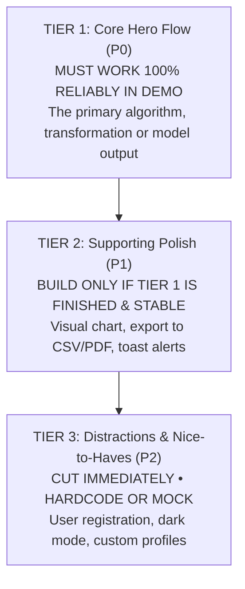
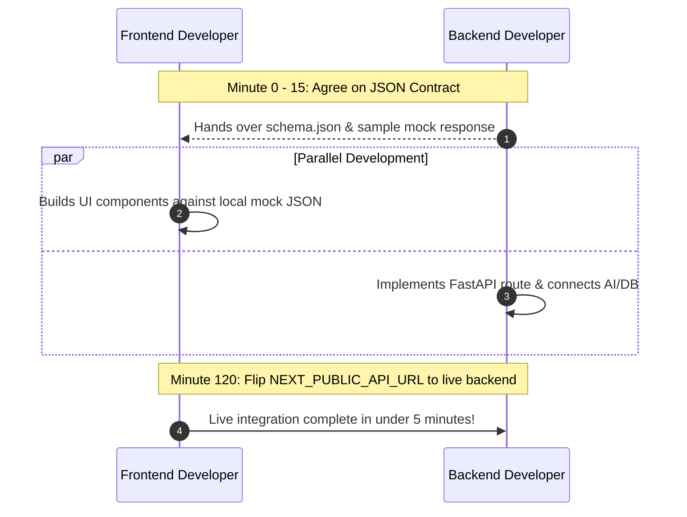

# Building an MVP Under Time Constraints

> "An MVP is not a broken, half-finished version of a 10-feature app. It is a complete, polished, working version of one core feature."

In a hackathon, time is your scarcest resource. Teams often run out of time because they try to build login systems, user settings, profile photo uploaders, payment gateways, and dark mode toggles before implementing the actual core intelligence of their product.

---

## 1. What is a Hackathon MVP?

A Minimum Viable Product (MVP) in a hackathon has one job: **to prove your core hypothesis works in front of an audience within 180 seconds.**

```mermaid
flowchart TD
    subgraph Full Vision [Over-Engineered Full Product Vision]
        V1[User Auth] --> V2[Profile Management]
        V2 --> V3[CORE ALGORITHM]
        V3 --> V4[Stripe Billing]
        V4 --> V5[Settings Page]
    end

    subgraph Hackathon MVP [The Winning Hackathon MVP]
        M1[Sample Pre-Filled Input] --> M2[CORE PROCESSING ENGINE]
        M2 --> M3[Interactive Output Card & Confidence Score]
    end

    Full Vision -.->|Scope Ruthlessly Cut 80%| Hackathon MVP
```

If your project is an automated document intelligence scanner, your MVP is:  
**Upload sample document ➔ Run extraction pipeline ➔ Display validated insight card.**  
You do NOT need email verification, password reset tokens, or billing tiers.

---

## 2. The Ruthless Scoping Rule: The 3-Tier Priority Pyramid



> [!TIP]
> **The 3-Minute Litmus Test:** If a feature does not directly contribute to the judge's "Aha!" moment during your 3-minute stage pitch on **31 October 2026**, **cut it**.

---

## 3. Battle-Tested Architecture Blueprint

A modular, decoupled architecture ensures that the frontend and backend developers can work in parallel without blocking each other:

```mermaid
flowchart LR
    subgraph Client [Frontend UI (Next.js / Tailwind)]
        UI1[Upload / Query Card] --> UI2[State & Local Mock Hook]
        UI2 --> UI3[Interactive Results Display]
    end

    subgraph Server [Backend Engine (FastAPI)]
        API[POST /api/process] --> Logic[Business Logic & Heuristics]
    end

    subgraph External [External Layer]
        AI[iNSIGHTS AI / Groq API]
        DB[(Supabase / Postgres)]
    end

    UI2 <==>|JSON API Contract| API
    API --> AI
    API --> DB
```

---

## 4. Preventing "Integration Hell" with Contract-First APIs

Integration breakdowns happen when developers code independently without agreeing on data structures beforehand. Prevent this with the **15-Minute Contract Protocol**:



### The Standard Contract Format:
```json
// POST /api/process
// Request Body:
{
  "query": "VTU examination schedule conflict",
  "document_type": "pdf",
  "enable_deep_search": true
}

// Response Body (200 OK):
{
  "status": "success",
  "timestamp": "2026-10-31T12:00:00Z",
  "data": {
    "summary": "Detected 3 overlapping course schedules.",
    "confidence_score": 0.94,
    "citations": ["VTU Academic Circular #2026-44"]
  }
}
```

---

## 5. Defensive Demo Engineering & Safety Nets

Conference and campus auditoriums frequently suffer from Wi-Fi congestion or API rate limits. Implement defensive safety nets:

1. **Try/Except Fallback Cache:** If the external AI API call fails or times out after 4 seconds, automatically catch the exception and return a realistic, pre-cached JSON payload.
2. **Zero Blank States:** Pre-populate your database with 5 to 10 realistic sample entries. The screen should look lively and functional immediately upon loading.
3. **Quick-Fill Buttons:** Add sample buttons like `[Try Sample Exam Schedule]` or `[Sample Medical Bill]` so presenters do not have to type live in front of judges.

---

## 6. Next Steps

- Practice defensive pitching: **[Pitching & Demos Guide](pitching-and-demos.md)**
- Fill out the architecture spec: **[MVP Planning Template](../templates/mvp-planning.md)**
