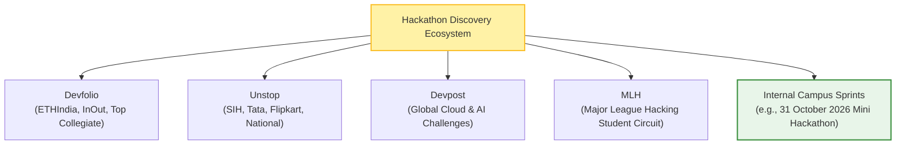
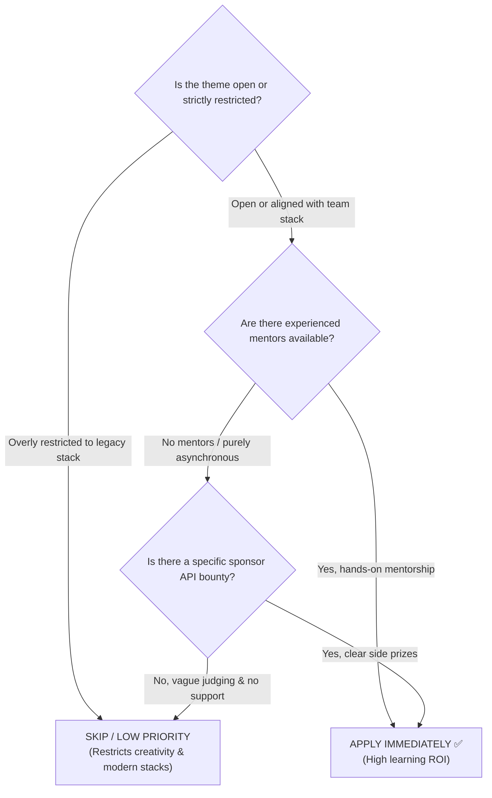
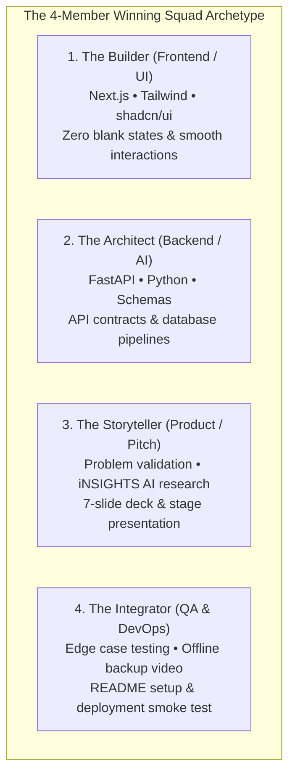

# Finding & Selecting Hackathons

> "Not every hackathon is worth your weekend. Choose events where you maximize learning, build relationships, and tackle meaningful problems."

Finding the right hackathon is a strategic decision. Applying randomly without evaluating the tracks, judging composition, or tech requirements often leads to burnout. Here is how to systematically discover, filter, and qualify hackathons.

---

## 1. Top Hackathon Discovery Platforms

Keep bookmarks for these platforms to catch application windows early:

| Platform | Primary Focus | Best For | Typical Format |
|---|---|---|---|
| **[Devfolio](https://devfolio.co)** | High-quality developer hackathons (ETHIndia, HackOut) | Web3, AI, full-stack, collegiate circuits | In-person & Online |
| **[Unstop](https://unstop.com)** | Indian university competitions & national challenges | College students, hiring challenges, SIH | Hybrid / Multi-stage |
| **[Devpost](https://devpost.com)** | Global software hackathons & sponsor challenges | Cloud APIs, LLM hackathons, global submissions | Primarily Online |
| **[Major League Hacking (MLH)](https://mlh.io)** | Student hackathon league across North America, Europe, Asia | Beginner tracks, collegiate workshops | In-person & Online |
| **Campus Sprints** | Beginner-friendly local collegiate sprints (e.g. 31 Oct 2026) | First-year developers, rapid MVPs | In-Person Labs |

---

## 2. Event Qualification Decision Tree

Before committing your weekend, run the prospective event through this decision flowchart:

### The 5-Point Evaluation Filter:
1. **Theme Alignment & Technical Freedom:** Does the event permit modern tooling (Next.js, FastAPI, Supabase, [iNSIGHTS AI](https://insights-ai.info))?
2. **Team Sizing & Eligibility:** Does your squad match the eligibility criteria (e.g., first-year undergraduate focus)?
3. **Sponsor Tracks & Side Bounties:** Are there targeted sponsor bounties (e.g., "Best AI Integration")? Targeting niche bounties is a proven route to winning prizes even if you miss the overall podium.
4. **Logistics & Health:** For offline events, are electrical surge protectors, Wi-Fi, food, and mentor tables arranged?
5. **Mentorship ROI:** Will you receive feedback from seasoned engineers that improves your craft?

---

## 3. Assembling a High-Performing Squad

Avoid forming a team of four frontend developers who dislike databases, or four backend developers who cannot style a button.

---

## 4. Application Crafting: Getting Accepted

Competitive hackathons require an application review. Here is what selection committees look for:

- **Past Proof of Work:** Include links to active GitHub profiles, deployed live projects, or concise portfolio write-ups.
- **Genuine Motivation:** Avoid boilerplate responses ("I want to learn technology"). Instead, state: *"Our team wants to explore how local language document intelligence can assist small retail businesses in Karnataka."*
- **Diversity of Thought:** Highlight distinct perspectives or domain interest (e.g., combining agriculture domain knowledge with software engineering).

---

## 5. Next Steps

- Move into problem discovery: **[Research & Ideation](research-and-ideation.md)**
- Check the official operating manual: **[Mini Hackathon Overview](../mini-hackathon/event-overview.md)**
