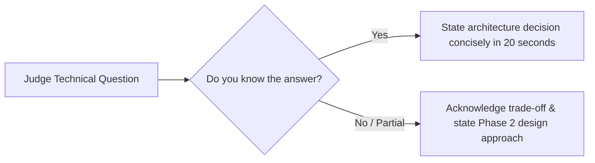
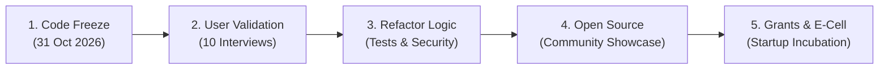

# Pitching, Demos & Post-Hackathon Strategy

> "You can build the most brilliant algorithm in the room, but if you cannot communicate what it does in 180 seconds, you will lose to a team with a working demo and a clear story."

Hackathons are ultimately evaluated through live presentations. Judges sit through dozens of consecutive presentations. A crisp, confident, story-driven pitch immediately commands attention and differentiates your team.

---

## 1. The 180-Second Hackathon Pitch Blueprint

```mermaid
gantt
    title The 3-Minute (180s) Pitch Countdown
    dateFormat X
    axisFormat %s sec

    section Hook & Problem
    Acute Pain & User Persona (Slide 1-2) :0, 30

    section Value Proposition
    The Breakthrough & Secret Sauce (Slide 3) :30, 20

    section The Live Demo
    HERO USER FLOW IN ACTION (Slide 4 / App) :crit, 50, 70

    section Engineering Depth
    System Architecture & Hurdles (Slide 5) :120, 35

    section Impact & Ask
    Feasibility, Roadmap & Closing (Slide 6-7) :155, 25
```



### Breakdown of the 7-Slide Pitch Deck:
1. **Slide 1: Title & One-Liner (0:00 - 0:15)** — Project name, memorable tagline, team member names.
2. **Slide 2: The Ground Reality (0:15 - 0:30)** — Acute user pain backed by verifiable data (e.g., hours lost, money wasted).
3. **Slide 3: The Breakthrough (0:30 - 0:50)** — How your architecture rethinks the workflow.
4. **Slide 4: LIVE DEMO (0:50 - 02:00)** — Switch display to the live browser window; run the uninterrupted hero flow.
5. **Slide 5: Architecture & Data Pipeline (02:00 - 02:35)** — Block diagram illustrating data ingestion, APIs, and AI models.
6. **Slide 6: Business & Feasibility (02:35 - 02:50)** — Target audience, unit cost per inference, deployment roadmap.
7. **Slide 7: The Team & Closing (02:50 - 03:00)** — Builder credits, QR code to live demo, transition to judge Q&A.

---

## 2. The Golden Rules of Live Demos

```mermaid
flowchart TD
    subgraph Presenter 1: The Narrator
        N1[Stands upright facing judges]
        N2[Tells the user story]
        N3[Explains the problem delta]
    end

    subgraph Presenter 2: The Pilot
        P1[Operates the laptop]
        P2[Clicks pre-filled sample inputs]
        P3[Keeps backup video queued in 2nd tab]
    end

    Presenter 1 <-->|Synchronized Choreography| Presenter 2
```

1. **Zero Blank States:** Never show empty dashboards. Pre-populate your database with 5 to 10 rich sample entries.
2. **Auto-Fill Buttons:** Do not make judges watch you type a 50-word prompt or email address live. Add buttons like `[Load Sample Document]` or `[Sample Query]`.
3. **The 5-Second Failover Rule:** If your web app or API spins for more than 5 seconds due to venue Wi-Fi, immediately say:
   > *"While the auditorium Wi-Fi establishes the socket connection, here is our 60-second screen recording of the exact model inference executed 15 minutes ago."*
   Switch to the local video immediately. **Never apologize for Wi-Fi; pivot to the contingency.**

---

## 3. Mastering Judge Q&A

Judges evaluate not just the code, but the engineering maturity of the team:



| Question Asked | Amateur Response | Winning Engineer Response |
|---|---|---|
| *"How will this scale to 100,000 users?"* | *"We'll just buy bigger servers."* | *"Our compute pipeline is stateless. We decouple compute-heavy inference with an asynchronous Redis queue and cache embeddings on edge workers."* |
| *"What if Google or OpenAI releases this next week?"* | *"They won't care about our niche."* | *"General LLMs lack localized regulatory schemas and offline edge connectors. Our moat is our private data pipeline and direct ERP integration."* |
| *"Does this feature actually work right now?"* | *"No, we ran out of time."* | *"The core extraction engine is running live. The automated notification dispatch is currently mocked out with stub endpoints and scheduled for Phase 2."* |

---

## 4. Turning a Hackathon Project into a Real Product



1. **User Validation:** Interview 10 potential users within 48 hours while the idea is fresh.
2. **Refactor & Decouple:** Replace hardcoded mocks with proper database schemas, environment variables, and unit tests.
3. **Open-Source Distribution:** Publish a detailed `README.md`, MIT license, and share an engineering breakdown on LinkedIn and X.
4. **Incubation & Student Grants:** Pitch your project to college innovation cells, entrepreneurship cells (E-Cells), VTU student project funds, and global accelerator fellowships.

---

## 5. Next Steps

- Review the presentation format: **[Pitch Deck Template](../templates/pitch-deck.md)**
- Benchmark against the official scorecard: **[Judging Scorecard](../templates/judging-scorecard.md)**
