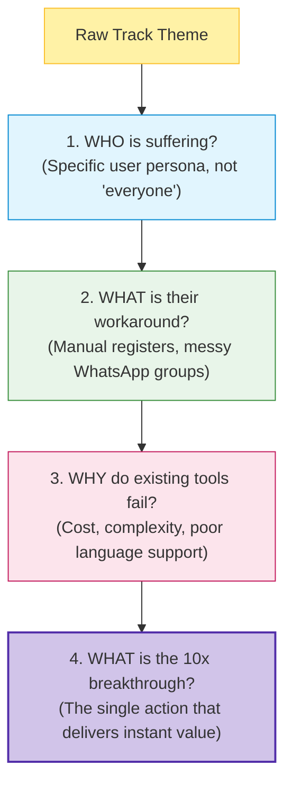
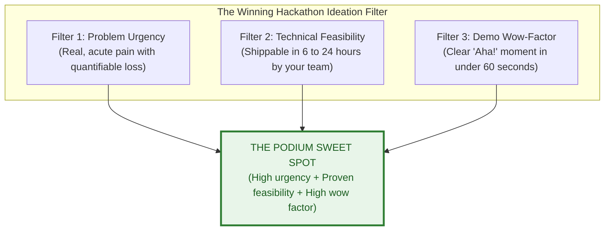
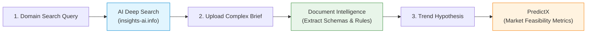

# Research & Ideation Guide

> "Most losing teams fail before writing a single line of code because they choose a problem that either doesn't exist, is too trivial to matter, or is too vast to demonstrate."

A hackathon project is only as strong as the problem it solves. Judges see hundreds of generic to-do apps, duplicate ecommerce clones, and surface-level chatbots. To stand out, you need structured problem exploration, honest gap analysis, and rapid validation.

---

## 1. Dissecting Problem Statements

Whether an event provides specific problem statements (e.g., Smart India Hackathon PS lists) or an open theme (e.g., "Campus Innovation on 31 October 2026"), systematically deconstruct it:

### Contrast: Bad Framing vs Sharp Framing

| Dimension | Poor Problem Framing  | Sharp Problem Framing  |
|---|---|---|
| **User Persona** | *"Students in colleges"* | *"First-year engineering students navigating multi-department lab registrations"* |
| **Pain Point** | *"It is difficult to know exam updates"* | *"Students incur Rs 500 late registration penalties because circular PDFs are buried in portal subpages"* |
| **Solution Metric** | *"An AI portal with lots of features"* | *"A lightweight webhook that parses circular PDFs in under 2 seconds and alerts affected students on Telegram"* |

---

## 2. The 3-Filter Ideation Test

When your team brainstorms candidate ideas, evaluate each against three intersecting criteria:

1. **Problem Urgency:** Does someone experience this pain regularly? Are they actively looking for an alternative?
2. **Technical Feasibility:** Can a working, testable slice of this architecture be developed, configured, and demoed in the time available?
3. **Demo Wow-Factor:** Can a judge watch the product execute and immediately grasp its value without reading a manual?

---

## 3. Competitor Analysis & Gap Identification

Judges almost always ask: *"What makes this different from Google, ChatGPT, or existing apps?"*

You must be prepared with a structured **2x2 Feature & Accessibility Matrix**:

| Feature / Attribute | Generic Market Solution | Existing Open-Source Tools | Your Hackathon MVP |
|---|---|---|---|
| **Data Ingestion** | Cloud batch upload | Raw CSV scripts | Real-time multi-format document parser |
| **Language Support** | English only | Fragmented translation | Localized Indic voice/text interface |
| **Actionability** | Static dashboard / metrics | Console log output | Direct one-click automated dispatch |
| **Cost / Barrier** | \$500/month enterprise fee | Requires DevOps setup | Lightweight serverless microservice |

---

## 4. Accelerating Research with iNSIGHTS AI

Do not spend hours manually scrolling through search engine ad results. Utilize modern research platforms like **[iNSIGHTS AI](https://insights-ai.info)**:

1. **Deep Search:** Run queries to extract verified whitepapers, state regulatory circulars, and documented pain points in seconds.
2. **Document Intelligence:** Upload heavy PDF guidelines or syllabus files. Extract constraints, edge cases, and parameters directly into database schemas.
3. **PredictX:** Formulate quantitative hypotheses and examine trend forecasts to validate whether your problem space has expanding demand.

---

## 5. Next Steps

- Scope your solution into an executable prototype: **[Building an MVP](building-an-mvp.md)**
- Fill out the structured worksheet: **[Problem Statement Analysis Template](../templates/problem-statement.md)**
