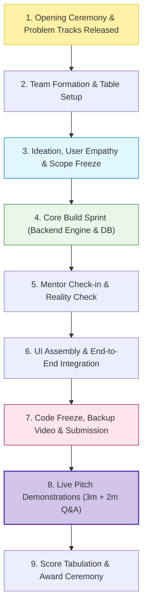

# What Are Hackathons?

> "A hackathon is not a test of what you already know. It is a high-speed engine for learning what you didn't know yesterday."

A hackathon is an intensive, time-bound invention sprint where developers, designers, and domain thinkers collaborate to take an idea from a blank screen to a functioning Minimum Viable Product (MVP). Sprints typically range from **6 hours (express mini sprints)** to **24–48 hours (weekend hackathons)**.

---

## 1. The Hackathon Lifecycle

Contrary to popular belief, hackathons are not about sitting silently in a dark room typing code for 48 hours without blinking. It is a compressed simulation of the startup product lifecycle:

---

## 2. Categories of Hackathons

Understanding the event category helps you pick the right stack, team, and mindset:

| Type | Focus Area | Deliverable Expected | Key Winning Factor |
|---|---|---|---|
| **Software / Web & Mobile** | Web apps, mobile applications, developer tooling | Deployed responsive web app or mobile APK | Smooth UX, zero latency, end-to-end working flow |
| **AI / Machine Learning** | LLM agents, document intelligence, predictive analytics | Live inference pipeline or interactive UI on top of model | Clear dataset justification, accurate evaluation, prompt engineering |
| **Hardware & IoT** | Microcontrollers (ESP32, Arduino, Pi), sensor networks | Physical hardware breadboard + firmware + dashboard | Reliability under demo conditions, physical sensor proof |
| **Social Impact & Civic Tech** | Public healthcare, civic reporting, accessibility | Scalable, low-barrier solution (e.g. multilingual, low-bandwidth) | Deep problem empathy, measurable societal impact, realistic adoption plan |
| **Mini Hackathons (e.g. 31 Oct 2026)** | Beginner-friendly 6-hour intensive build sprints | Working MVP of single Hero User Flow + 7-slide deck | Fast execution, clear scope, confident pitch |

---

## 3. Myths vs. Reality

| Common Myth ❌ | Ground Reality ✅ |
|---|---|
| *"I need to know everything before I register."* | Hackathons are learning engines. Most winning teams learn new libraries and APIs *during* the sprint. |
| *"Only 10x senior full-stack developers win."* | Teams that win usually do so because of **problem clarity, clean execution, and presentation**, not sheer lines of code. |
| *"You have to stay awake all night without sleep."* | Sleep-deprived teams write buggy code that crashes during judges' demos. Teams that sleep 5–6 hours demo reliably. |
| *"You must build a complete production enterprise product."* | You are building an **MVP (Minimum Viable Product)**. Focus on one complete, flawless user story instead of ten half-broken features. |

---

## 4. Beginner Tips for Success

1. **Rule of One User Flow:** A judge gives your demo 2 to 3 minutes. Design your product so that the single most important action happens seamlessly in under 60 seconds.
2. **Lock Scope Early:** Stop adding new features after the halfway mark. Treat the second half as testing, edge-case handling, and presentation preparation.
3. **Commit Regularly:** Never leave git pushes to the last 15 minutes before the portal closes. Push early, push often, and branch properly.
4. **Prepare for Network Outages:** Always record a 60-second backup demo video of your working prototype stored locally on your laptop in case venue Wi-Fi drops during judging.

---

## 5. Next Steps

- Explore how to find upcoming hackathons: **[Finding & Selecting Hackathons](finding-hackathons.md)**
- Learn how to structure brainstorming: **[Research & Ideation](research-and-ideation.md)**
