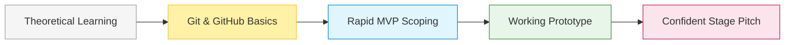
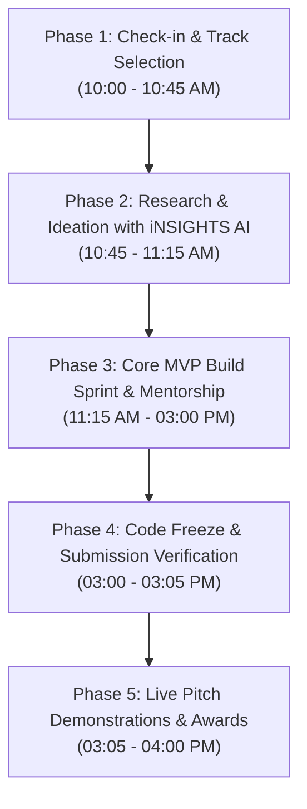

# Mini Hackathon: Event Overview

> **A beginner-friendly, high-velocity build sprint where students turn real-world problems into working MVPs.**

The **Mini Hackathon** is the operational flagship event designed specifically to lower the barrier to entry for early-stage engineering students (including first-year undergraduates). This format combines rapid prototyping, active mentorship, and structured evaluation.

> [!IMPORTANT]
> **📅 EVENT SPECIFICATION**  
> **Date:** Saturday, 31 October 2026  
> **Time:** 10:00 AM – 4:00 PM IST (6-Hour Build Sprint)  
> **Venue:** Campus Innovation Lab / Seminar Hall  
> **Format:** In-Person Offline Sprint  
> **Team Sizing:** 2 to 4 Members per team (Interdisciplinary teams encouraged)  
> **Registration Fee:** INR 400 per team  
> **Prize Pool:** INR 5,000 baseline cash pool + Category awards + Official Certificates

---

## 1. Objectives & Expected Outcomes

### Core Objectives:
- **Demystify Building:** Transition students from theoretical classroom programming to shipping functioning applications.
- **Hands-on Version Control:** Ensure every participant masters `git clone`, branch workflows, and clean commit hygiene.
- **Validate Fast:** Teach teams to define a realistic MVP scope that can be built and demonstrated in hours, not months.
- **Confidence in Public Speaking:** Provide a supportive, constructive stage to pitch projects directly to senior mentors and industry judges.

### Tangible Outcomes for Every Participant:
1. A live public GitHub repository with clear setup documentation.
2. A working functional prototype (web, mobile, script, or hardware dashboard).
3. A 7-slide pitch deck and structured presentation experience.
4. Direct feedback from evaluators and access to the builder network.

---

## 2. Event Structure & 5-Phase Pipeline

---

## 3. Core Themes & Problem Tracks

Teams select one track during the kickoff on **31 October 2026**:

| Track | Focus Domain | Sample Problem Statement | Example MVP Solution |
|---|---|---|---|
| **Track 1: Campus & EdTech** | Student workflow, administrative friction, peer resources | Students miss elective deadlines due to fragmented noticeboards | Telegram/WhatsApp automated scraper bot with deadline calendar sync |
| **Track 2: Civic Tech & Regional Impact** | Public infrastructure, waste management, municipal data | Local shopkeepers struggle with complex GST document calculations | Voice-first bilingual receipt parser using OCR & summary API |
| **Track 3: AI for Good & Practical Automation** | Intelligent parsing, accessibility, predictive tooling | Visually impaired students cannot navigate unstructured syllabus PDFs | Audio-interactive document QA reader powered by [iNSIGHTS AI](https://insights-ai.info) |

---

## 4. Participant Deliverables

Before the **3:00 PM Code Freeze** on 31 October 2026, every team must submit:

- [ ] **Public GitHub Repo Link:** Must contain incremental commits authored during the sprint.
- [ ] **Project README.md:** Follows the [Project README Template](../templates/project-readme.md) with local setup instructions.
- [ ] **Working Demo URL / Local Executable:** Live deployment on Vercel/Render, or locally running script.
- [ ] **7-Slide Pitch Deck:** PDF or view-only Google Slides link using the [Pitch Deck Template](../templates/pitch-deck.md).
- [ ] **60-Second Backup Video:** Screen recording of the working demo stored locally or hosted on Drive/Loom.

---

## 5. Next Steps

- Review the code policies and ethics: **[Rules & Guidelines](rules-and-guidelines.md)**
- Check the exact minute-by-minute schedule: **[Event Timeline](timeline.md)**
- View the scoring rubric: **[Judging Criteria](judging-criteria.md)**
