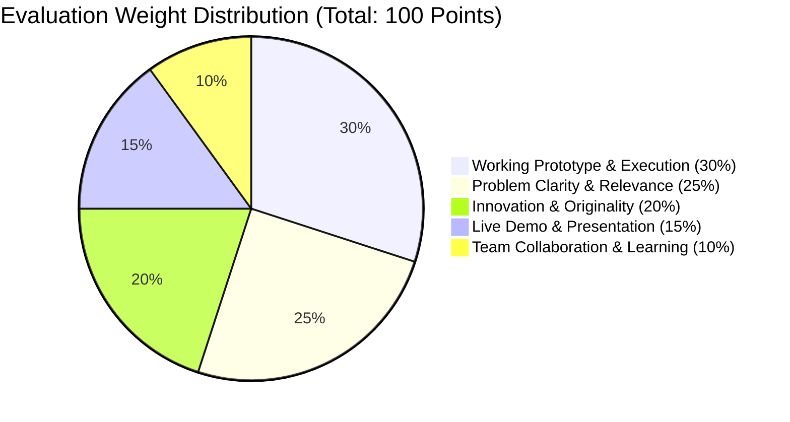

# Mini Hackathon: Judging Criteria & Rubric

> **Official Evaluation Rubric for the 31 October 2026 Sprint**  
> Total: **100 Points** &nbsp;|&nbsp; 3-Minute Live Pitch + 2-Minute Judge Q&A

All projects are evaluated against an objective, weighted rubric designed to reward working software, acute problem understanding, and engineering clarity.

---

## 1. Weighted Rubric Distribution



---

## 2. Detailed Scoring Breakdown

```
┌─────────────────────────────────────────────────────────────┐
│ 1. Problem Clarity & Relevance                     [25 pts] │
├─────────────────────────────────────────────────────────────┤
│ 2. Working Prototype & Technical Execution         [30 pts] │
├─────────────────────────────────────────────────────────────┤
│ 3. Innovation & Originality                        [20 pts] │
├─────────────────────────────────────────────────────────────┤
│ 4. Live Demo & Presentation Clarity                [15 pts] │
├─────────────────────────────────────────────────────────────┤
│ 5. Team Collaboration & Learning                   [10 pts] │
└─────────────────────────────────────────────────────────────┘
```

### Criterion 1: Problem Clarity & Relevance (25 Points)
- **1–10 pts (Poor):** Vague, generic concept ("An app for education"). No specific persona identified; solution in search of a problem.
- **11–18 pts (Average):** Identifies a real pain point, but lacks research into existing alternatives or market gaps.
- **19–25 pts (Exceptional):** Laser-focused problem. The team articulates *who* suffers, *why* existing tools fail, and supports their thesis with verified data (e.g. from [iNSIGHTS AI](https://insights-ai.info) Deep Search).

### Criterion 2: Working Prototype & Technical Execution (30 Points)
- **1–10 pts (Poor):** Static Figma wireframes or non-interactive HTML mocks only; no working code logic.
- **11–20 pts (Average):** Partial implementation with broken paths, console errors, or heavy hardcoded illusions without backend API communication.
- **21–30 pts (Exceptional):** Seamless end-to-end working MVP. The hero user flow executes live without crashing. Clean code structure, proper API contracts, and graceful error handling.

### Criterion 3: Innovation & Originality (20 Points)
- **1–8 pts (Poor):** Direct clone of a known tutorial (e.g., simple to-do list, generic blog, duplicate social media clone).
- **9–15 pts (Average):** Standard solution with minor cosmetic changes.
- **16–20 pts (Exceptional):** Differentiated angle, novel combination of APIs, creative use of AI document intelligence, or significant UX breakthrough for the target user.

### Criterion 4: Live Demo & Presentation Clarity (15 Points)
- **1–5 pts (Poor):** Disorganized, exceeded the 3-minute limit, slides too text-heavy, live demo failed with no backup video.
- **6–10 pts (Average):** Clear presentation, but spent 2.5 minutes talking about background slides and rushed through the actual prototype in 30 seconds.
- **11–15 pts (Exceptional):** Crisp 180-second delivery. Showed working software within the first 60 seconds. Confident, crisp answers to judge technical questions.

### Criterion 5: Team Collaboration & Learning (10 Points)
- **1–4 pts (Poor):** Only one member spoke; others could not explain what the code does.
- **5–7 pts (Average):** Decent team effort, but roles were unclear.
- **8–10 pts (Exceptional):** Excellent team synergy. Clear division of roles, evidence of mastering new libraries during the sprint, and shared ownership of the repository.

---

## 3. Judge Score Calibration Matrix

To prevent score inflation and ensure fairness across judging panels:

| Final Total Score | Interpretation | Expected Distribution |
|---|---|---|
| **Below 50** | Non-functioning submission; missing key components | Bottom 10% |
| **50 – 69** | Partial prototype, basic concept, needs heavy iteration | Typical middle 50% |
| **70 – 84** | Strong working MVP, good problem framing, stable demo | Top 30% |
| **85 – 100** | Exceptional, production-ready hackathon execution; podium contender | Top 10% |

---

## 4. Next Steps

- Review what teams must submit: **[Submission Guidelines](submission-guidelines.md)**
- Print the scoring sheet: **[Judging Scorecard Template](../templates/judging-scorecard.md)**
