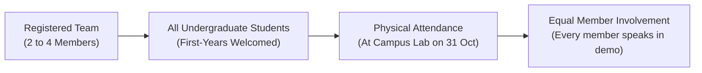

# Mini Hackathon: Rules & Guidelines

> **Sprint Date:** Saturday, 31 October 2026 &nbsp;|&nbsp; **Venue:** Campus Innovation Lab &nbsp;|&nbsp; **Hours:** 10:00 AM – 4:00 PM

To ensure a fair, competitive, and supportive learning environment for all builders, every participant must strictly adhere to the following rules.

---

## 1. Original Code & Academic Integrity

```
ALLOWED & ENCOURAGED                           STRICTLY FORBIDDEN 
─────────────────────────────────────────────   ─────────────────────────────────────────────
• Public open-source libraries (npm, pip)       • Cloning a complete pre-existing repo
• Official framework starters (Next.js, Vite)   • Re-submitting code from an earlier event
• Public pre-trained models (Groq, HF, OpenAI)  • Writing project-specific logic before 10 AM
• Cloud services & BaaS (Supabase, Firebase)     • Claiming third-party code as your own
• Research & document parsing (iNSIGHTS AI)     • Single-commit repos with 5,000 pre-made lines
```

### Git Commit Transparency
- All code must be pushed to a **public GitHub repository**.
- Evaluators will inspect commit histories. Repositories must show natural progress throughout the **31 October 2026** sprint.
- A repository containing a single commit with a fully completed codebase pushed at the start will be disqualified immediately.

---

## 2. Team Composition & Eligibility



1. **Team Size:** 2 to 4 members. Solo hacking is prohibited in the finals.
2. **Eligibility:** Must be actively enrolled undergraduate students. College ID cards must be presented at the check-in desk at 10:00 AM.
3. **Cross-Disciplinary Teams:** Teams combining computer science, electronics, mechanical, and business/design thinkers are highly encouraged.

---

## 3. Technology, AI Ethics & Responsible Data Use

- **Understanding Your Tools:** Using GitHub Copilot, ChatGPT, or [iNSIGHTS AI](https://insights-ai.info) is permitted. However, every team member must be able to explain the architecture and code decisions. If a team cannot explain how an API route works, they will lose execution points.
- **Data Privacy & Web Scraping:** Scraping proprietary college portals without permission or handling sensitive personally identifiable information (PII) is forbidden. Use public datasets or synthetic sample data.
- **Intellectual Property (IP):** Teams retain **100% full intellectual property ownership** of everything created during the hackathon. All submissions should include an open-source license (such as MIT).

---

## 4. Code of Conduct & Fair Play

The hackathon is a professional, inclusive space:

- **Mutual Respect:** Harassment, discriminatory language, or deliberate interference with other teams will result in instant expulsion.
- **Reporting Misconduct:** Immediately notify any organizer wearing an official badge.

---

## 5. Disqualification Summary

A team will be disqualified if:
1. They submit plagiarized code or a pre-built commercial application.
2. They do not complete the project submission before the **3:00 PM Code Freeze** on 31 October 2026.
3. They deliberately tamper with venue networking equipment or campus Wi-Fi infrastructure.

---

## 6. Next Steps

- Review the detailed timeline: **[Event Timeline](timeline.md)**
- Check evaluation rubrics: **[Judging Criteria](judging-criteria.md)**
