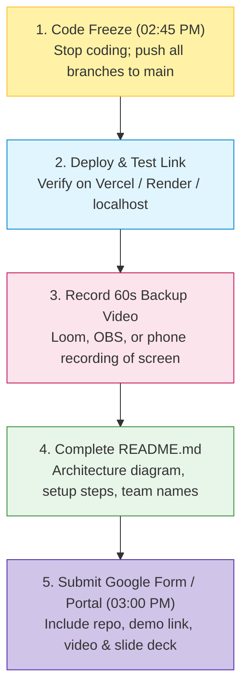

# Mini Hackathon: Submission Guidelines

> **Deadline:** Saturday, 31 October 2026 at **03:00 PM Sharp IST**  
> Late Submissions: Subject to **-10 points per 5 minutes of delay** up to 15 minutes.

Every team must complete their final project submission through the official portal before the timer strikes 03:00 PM. Read this guide to ensure your submission passes verification on the first attempt.

---

## 1. Visual Submission Flow



---

## 2. Mandatory Deliverables Checklist

```
┌─────────────────────────────────────────────────────────────┐
│ 1. Public GitHub Repository Link with Commit History        │
├─────────────────────────────────────────────────────────────┤
│ 2. Project README.md with Local Setup Commands              │
├─────────────────────────────────────────────────────────────┤
│ 3. Working Deployed Link OR Step-by-Step Local Run Command  │
├─────────────────────────────────────────────────────────────┤
│ 4. 7-Slide Pitch Deck (PDF or Public View Link)             │
├─────────────────────────────────────────────────────────────┤
│ 5. 60–90 Second Screen-Recorded Backup Demo Video           │
└─────────────────────────────────────────────────────────────┘
```

### Detailed Deliverable Requirements:

| Deliverable | Format / Platform | Pass Criteria | Fail Criteria |
|---|---|---|---|
| **1. GitHub Repo** | GitHub public link | Incremental commits during 31 Oct; `.gitignore` used | Private repo; 404 error; single commit |
| **2. README.md** | Markdown in repo root | Follows [Project README Template](../templates/project-readme.md) with setup instructions | Empty file; default "Create React App" text |
| **3. Live URL / Executable** | Vercel, Render, or local script | Loads without login wall; seeded with sample data | 500 server error; crashes on first click |
| **4. Pitch Deck** | PDF or Google Slides link | Max 7 slides; permission set to *"Anyone with link can view"* | Requires Google login access request |
| **5. Backup Video** | YouTube (Unlisted), Loom, or Drive | Clear 60-90s recording showing the core user flow | Video requires permission; missing audio |

---

## 3. Pre-Submission Self-Audit (The 5-Minute Drill)

Before pressing submit at 02:55 PM, run this checklist:

- [ ] **Incognito Test:** Open your GitHub repo and deployed URL in a clean **Incognito / Private tab**. Does it load without asking for a password?
- [ ] **Permission Verification:** Open your Google Slides or Loom video link in an Incognito tab. Can an external viewer see it?
- [ ] **Secret Sanitization:** Verify that no `.env` files with secret API tokens (e.g. OpenAI keys, database passwords) were committed to GitHub history.
- [ ] **Dependencies Listed:** Does your repository include a valid `package.json` or `requirements.txt`?
- [ ] **Team Members Credited:** Are all team members and their contributions listed in the README?

---

## 4. Emergency Failover Plan

What to do if something breaks at 02:50 PM:

- **Cloud Deployment Failed:** Switch your submission URL to `http://localhost:3000` and clearly document local run steps (`npm run dev` or `python main.py`) in the README.
- **Wi-Fi Down:** Turn on mobile hotspot immediately. Ensure your 60-second backup video is saved locally on your laptop hard drive so you can play it offline for judges.

---

## 5. Next Steps

- Review the presentation format: **[Pitching & Demos Guide](../guides/pitching-and-demos.md)**
- Use the presentation deck structure: **[Pitch Deck Template](../templates/pitch-deck.md)**
