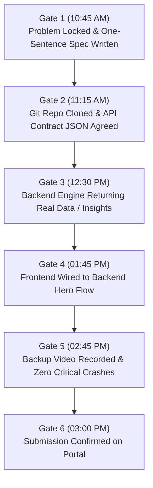

# Mini Hackathon: Event Timeline & Pacing

> **Event Date:** Saturday, 31 October 2026 &nbsp;|&nbsp; **Duration:** 10:00 AM – 4:00 PM IST (6-Hour Express Sprint)

Pacing is the single greatest predictor of hackathon success. Teams that manage their time finish their prototypes with an hour to spare; teams that lose track of time end up debugging CSS when judging begins.

---

## 1. Master 6-Hour Express Timeline (31 October 2026)

```mermaid
gantt
    title 6-Hour Sprint Schedule: Saturday, 31 October 2026
    dateFormat HH:mm
    axisFormat %H:%M

    section Opening
    Check-in, Desk Setup & Wi-Fi Check :10:00, 20m
    Tracks, Rules & Rubric Briefing    :10:20, 25m

    section Research
    Ideation & Scope Freeze (iNSIGHTS AI) :crit, 10:45, 30m

    section Build Sprint 1
    Backend Setup & Core Engine Sprint :active, 11:15, 60m
    Mentor Roundtable Check-in Round 1 :crit, 12:15, 45m

    section Break
    Refreshment, Tea & Networking      :13:00, 25m

    section Build Sprint 2
    UI Wiring & End-to-End Integration :active, 13:25, 50m
    Mentor Pitch & Smoke-Test Check-in :crit, 14:15, 30m
    Offline Backup Video Recording     :crit, 14:45, 15m
    CODE FREEZE & FINAL SUBMISSION     :crit, 15:00, 5m

    section Showcase
    Live Presentations & Panel Q&A     :active, 15:05, 40m
    Scoring Tabulation & Awards        :15:45, 15m
```



---

## 2. Milestone Pacing & Gate Checkpoints

To ensure your team ships on time, treat each hour as a hard checkpoint gate:



### Detailed Checkpoint Actions:

| Checkpoint | Time Target | Green Signal (On Track) | Red Signal (Action Required) | Emergency Intervention |
|---|---|---|---|---|
| **Gate 1: Problem** | 10:45 AM | Specific user persona & acute pain defined | Debating 4 different concepts | Pick the simplest idea with available APIs |
| **Gate 2: Contract** | 11:15 AM | JSON schemas agreed; branches created | Teammates coding without talking | Sit together for 10 mins to write `schema.json` |
| **Gate 3: Engine** | 12:30 PM | Primary algorithm or AI response works | Model throws errors or API fails | Replace failing API with cached local mock |
| **Gate 4: UI Sync** | 01:45 PM | Frontend renders API response on screen | Blank screen / CORS errors | Test API via Postman / bypass CORS in FastAPI |
| **Gate 5: Defense** | 02:45 PM | 60s backup video recorded; deck ready | Still writing new features | **STOP CODING.** Rehearse pitch immediately |
| **Gate 6: Submit** | 03:00 PM | Form submitted with public links | Submitting at 03:02 PM | Late penalties apply (-10 pts / 5 mins) |

---

## 3. The 24-Hour Weekend Timeline (Alternative Format)

For multi-day editions:

```
DAY 1:
10:00 AM  Kickoff, Problem Tracks Released & Team Check-in
11:00 AM  Ideation, User Research & API Contract Definition
01:00 PM  Lunch & Networking
02:00 PM  Build Sprint 1: Database Schemas & Core Engine
05:30 PM  Tea Break & Mentor Progress Review 1
07:00 PM  Build Sprint 2: UI Scaffolding & Component Assembly
09:00 PM  Dinner & Mid-Sprint Scoping Reality Check (Cut Tier 3)
11:30 PM  Late Night Integration: Connect Frontend to Backend

DAY 2:
02:00 AM  Midnight Sync Checkpoint: Resolve Git merge conflicts
06:00 AM  Breakfast & Final Bug Bash
07:30 AM  Dry Run: Test on clean browser / incognito tab
08:30 AM  Record offline backup demo video
09:30 AM  CODE FREEZE & FINAL SUBMISSION PORTAL LOCKS
10:00 AM  Preliminary Judging Heats
02:00 PM  Top 10 Teams Stage Pitches
03:30 PM  Awards & Celebration
```

---

## 4. Next Steps

- Understand the evaluation criteria: **[Judging Criteria](judging-criteria.md)**
- Review submission rules: **[Submission Guidelines](submission-guidelines.md)**
