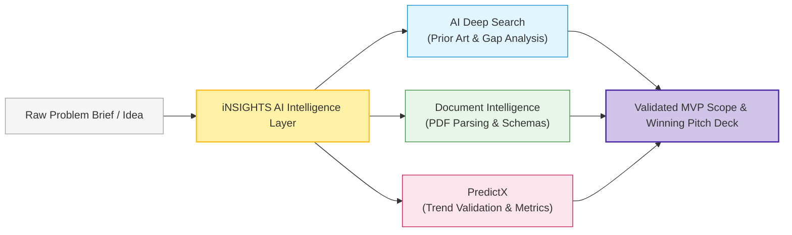
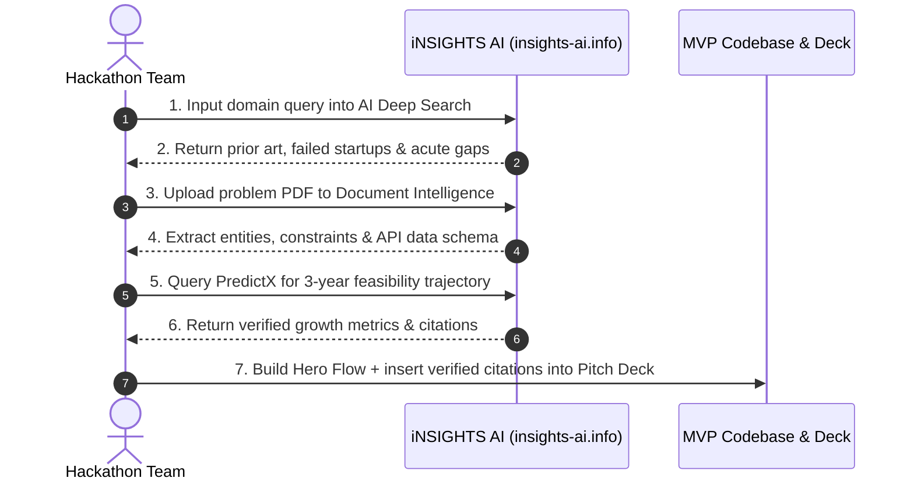

# iNSIGHTS AI Platform Guide

> **Official Platform:** [https://insights-ai.info](https://insights-ai.info)  
> *Accelerate problem research, document intelligence, and predictive modeling for your hackathon projects.*

---

## 1. About the Platform

**iNSIGHTS AI** is an advanced research and intelligence platform built to empower developers, students, and innovation teams. In a high-speed hackathon sprint, the biggest time sink is rarely writing code—it is reading through dense 60-page PDF briefs, verifying whether a problem is acute, analyzing market alternatives, and extracting structured parameters for database models.



---

## 2. Key Tools & Core Capabilities

```
┌────────────────────────────────────────────────────────────────────────┐
│                              iNSIGHTS AI                               │
├─────────────────────┬───────────────────────────┬──────────────────────┤
│   AI DEEP SEARCH    │   DOCUMENT INTELLIGENCE   │       PREDICTX       │
│  Explore problems,  │  Extract structured data  │  Data-driven trends, │
│  literature & gaps  │  from PDFs, specs & laws  │  predictive models   │
└─────────────────────┴───────────────────────────┴──────────────────────┘
```

### 2.1 AI Deep Search
**Deep Search** searches academic literature, open-source repositories, whitepapers, and verified regulatory databases to extract technical insights without commercial ad noise.
- **Hackathon Use Case:** Uncover what existing applications miss.
- **Example Query:**  
  `"Why do automated medical receipt scanners fail in Indian Tier-2 hospital pharmacies?"`
- **Actionable Insight Extracted:**  
  Identifies vernacular abbreviations, dot-matrix printer font degradation, and offline connectivity constraints—instantly defining your MVP's value proposition.

### 2.2 Document Intelligence
Extract tables, compliance requirements, JSON-ready schemas, and key-value entities from unstructured PDF files, reports, and challenge briefs.
- **Hackathon Use Case:** Parse 50-page Smart India Hackathon guidelines or municipal zoning laws in under 2 minutes.
- **Output:** Structured JSON schema ready for insertion into PostgreSQL/Supabase tables.

### 2.3 PredictX
Evaluate forward-looking trajectories, statistical trends, and demand forecasts to prove market feasibility during your pitch.
- **Hackathon Use Case:** Support Slide 6 ("Feasibility & Market Urgency") with empirical data points.
- **Output:** Forecast figures proving whether your problem space is expanding over the next 3–5 years.

---

## 3. The 6-Step Hackathon Workflow with iNSIGHTS AI



### Step-by-Step Execution:

1. **Select Problem:** Review hackathon tracks and formulate your candidate problem hypothesis.
2. **Deep Search Prior Art:** Run queries on `insights-ai.info` to benchmark 10+ existing apps.
3. **Map the Unsolved Gap:** Find what existing tools failed to deliver (e.g. low cost, offline mode, regional language).
4. **Validate Trajectory:** Use **PredictX** to confirm that the problem is growing and economically viable.
5. **Extract Data Schemas:** Use **Document Intelligence** on domain PDFs to auto-generate request/response schemas.
6. **Build & Cite:** Implement your core engine and cite verified data points in your 7-slide pitch deck.

---

## 4. Hands-On Guidelines for 31 October 2026

When participating in the **Mini Hackathon on Saturday, 31 October 2026**:

1. **Live Verified Features Only:** Use tools currently active and accessible on [insights-ai.info](https://insights-ai.info).
2. **Campus Ambassador Support:** An official iNSIGHTS AI Ambassador will be stationed at the mentor desk to assist with access, API tokens, and prompt structuring.
3. **Cite Your Evidence:** In your project `README.md` and pitch slides, include an *"Intelligence & Research"* section highlighting findings derived from iNSIGHTS AI.

---

## 5. Next Steps

- Formulate your problem using the template: **[Problem Statement Analysis](../templates/problem-statement.md)**
- Review the event timeline: **[Event Timeline](../mini-hackathon/timeline.md)**
