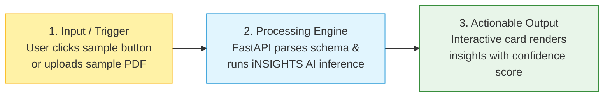
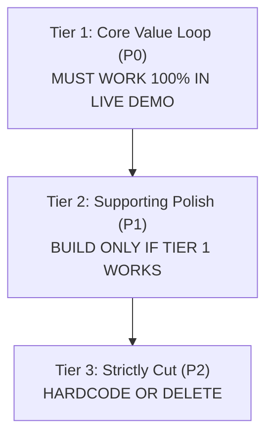

# Template: MVP Planning & Tech Architecture

> Lock your scope early. Fill out this spec before writing code to prevent mid-sprint drift and avoid integration breakdowns.  
> **Sprint Target:** Saturday, 31 October 2026 &nbsp;|&nbsp; **Code Freeze:** 03:00 PM IST

---

## 1. The Single Core User Flow (The Hero Flow)

Define the exact 3-step action that judges will witness during your live demo:



- **Step 1 (Input Trigger):** `[Specify input: e.g., Pre-filled sample circular PDF upload]`
- **Step 2 (Transformation Engine):** `[Specify backend logic: e.g., FastAPI regex + iNSIGHTS AI Document Intelligence]`
- **Step 3 (Visual Output Card):** `[Specify UI card: e.g., Telegram preview card + downloadable calendar invite]`

---

## 2. Feature Prioritization & Scope Cut List



### Tier 1: Core Value Loop (P0 — Non-negotiable for Demo)
- [ ] `[Feature 1: e.g., Document upload and parsing]`
- [ ] `[Feature 2: e.g., AI inference / insight generation]`
- [ ] `[Feature 3: e.g., Result display card with confidence score]`

### Tier 2: Supporting Polish (P1 — Build only if Tier 1 is verified)
- [ ] `[Feature 1: e.g., Quick sample input buttons]`
- [ ] `[Feature 2: e.g., Download summary as PDF / CSV]`
- [ ] `[Feature 3: e.g., Toast notifications for status changes]`

### Tier 3: Cut Features (P2 — Strictly Prohibited During Sprint)
- [x] Custom user avatars and bio editors *(Use mock user: "Alex / Demo User")*
- [x] Email OTP verification *(Hardcode authentication or skip auth entirely)*
- [x] Payment gateway checkout *(Simulate with a fake success modal)*

---

## 3. Technical Architecture & Tech Stack

```
Frontend:   [Next.js 14 (App Router) + Tailwind CSS + shadcn/ui]
Backend:    [Python 3.11 + FastAPI + Uvicorn]
Database:   [Supabase PostgreSQL OR SQLite with local pre-seeded data]
AI Engine:  [iNSIGHTS AI APIs (insights-ai.info) / Groq Llama 3]
Hosting:    [Vercel (Client) + Render (API Server)]
```

---

## 4. API Contract & Data Schemas

Establish schemas between frontend and backend developers **before** writing implementation code:

### Primary Endpoint: `POST /api/process`

**Request Payload (JSON):**
```json
{
  "project_id": "sprint-2026-10-31",
  "input_text": "Sample circular text or base64 encoded document",
  "options": {
    "include_metrics": true
  }
}
```

**Response Payload (JSON):**
```json
{
  "status": "success",
  "timestamp": "2026-10-31T12:00:00Z",
  "result": {
    "summary": "Core insight generated by engine...",
    "score": 92.4,
    "tags": ["urgent", "verified"]
  }
}
```

---

## 5. Fallback Contingency Plan

- **If external API experiences rate limiting:** `[Fallback to local cached mock JSON responses]`
- **If venue Wi-Fi becomes unstable:** `[Switch to pre-recorded 60-second offline demo video]`
- **If cloud deployment fails at submission:** `[Run local dev server with pre-seeded database]`
