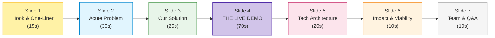

# Template: 7-Slide Hackathon Pitch Deck

> Optimized for a 3-minute pitch followed by 2 minutes of Q&A. Keep slide text minimal; let your voice and working demo carry the presentation.  
> **Presentation Date:** Saturday, 31 October 2026 &nbsp;|&nbsp; **Strict Time Limit:** 180 Seconds

---

## Visual Slide Deck Architecture

---

## Slide 1: Cover & Hook (15 Seconds)
- **Visual:** High-contrast logo, project name, memorable tagline.
- **Header:** `[Project Name]` — *The `[X]` for `[Y]`*
- **Sub-bullets:**
  - Team Name: `[e.g., Team Alpha]`
  - Track: `[e.g., Track 1: Campus & EdTech]`
  - Presenters: `[Names of teammates]`
- **Speaker Cue:** *"Good morning judges. Every year, thousands of first-year engineering students struggle with [pain point]. Today, on 31 October 2026, we built [Project Name] to solve this once and for all."*

---

## Slide 2: The Problem (30 Seconds)
- **Visual:** A single compelling image or bold quantitative metric.
- **Key Points:**
  - The acute reality: `[Who suffers and what happens?]`
  - The cost of inaction: `[Hours wasted, money lost, or friction endured]`
  - Why existing tools fail: `[Too complex, expensive, or not localized]`
- **Speaker Cue:** *"Currently, students are forced to rely on [workaround], which leads to [failure mode]. We validated this through [X] interviews and domain research using iNSIGHTS AI."*

---

## Slide 3: The Solution & Value Proposition (25 Seconds)
- **Visual:** 3 clean icons highlighting core superpowers.
- **Key Points:**
  - Superpower 1: `[Instant processing / intelligence]`
  - Superpower 2: `[Frictionless, localized interface]`
  - Superpower 3: `[Automated actionable outcome]`
- **Speaker Cue:** *"[Project Name] bridges this gap with an intuitive platform that does [core action] in seconds. Let's see it working live."*

---

## Slide 4: LIVE DEMO (60–75 Seconds)
- **Action:** Switch display immediately to the live browser window or emulator.
- **Key Flow:**
  1. Trigger the input: Click `[Sample Dataset]`.
  2. Execute the engine: Click `[Process / Analyze]`.
  3. Show the output: Point out the returned analysis and real-time updates.
- **Speaker Cue:** *"Watch as we upload this sample document. Notice how our backend parses the schema in under 800ms and generates this verified report..."*

---

## Slide 5: System Architecture & Tech Stack (20 Seconds)
- **Visual:** Clean block architecture diagram showing data flow.
- **Key Blocks:**
  - Frontend: `Next.js, Tailwind CSS, shadcn/ui`
  - Backend: `FastAPI (Python), Pydantic`
  - Data / Cloud: `Supabase PostgreSQL, Vercel`
  - Intelligence: `Groq / iNSIGHTS AI APIs`
- **Speaker Cue:** *"Under the hood, we designed a stateless microservice pipeline that decouples compute-heavy extraction from our responsive UI, ensuring zero UI freezing."*

---

## Slide 6: Feasibility, Impact & Market Potential (10 Seconds)
- **Visual:** 2x2 comparison matrix or unit impact metric.
- **Key Points:**
  - Potential Reach: `[e.g., 20,000 students across affiliated colleges]`
  - Cost to Operate: `[e.g., Under $0.002 per analysis via serverless edge workers]`
  - Next Steps: `[Direct integration with college portal / open beta]`
- **Speaker Cue:** *"With our low operational cost, this architecture can be deployed campus-wide with zero additional server overhead."*

---

## Slide 7: The Team & Closing (10 Seconds)
- **Visual:** Team photos, GitHub links, QR code to live demo.
- **Header:** *"Thank you! We are Team [Name]. We're ready for your questions."*
- **Speaker Cue:** *"Scan the QR code to try our live deployment on Vercel. We welcome your questions."*
