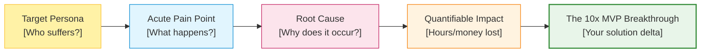

# Template: Problem Statement Analysis

> Use this worksheet during Phase 2 (Ideation & Research) to dissect your problem statement, identify market gaps, and validate your direction.  
> **Sprint Date:** Saturday, 31 October 2026 &nbsp;|&nbsp; **Target Submission:** 03:00 PM IST

---

## 1. Problem Identification

- **Project Title / Working Name:** `[Your Project Name]`
- **Hackathon Track / Category:** `[ ] Track 1: Campus & EdTech   [ ] Track 2: Civic Tech   [ ] Track 3: AI for Good`
- **The One-Sentence Problem Statement:**  
  *`[Who]` suffers from `[specific pain point]` because `[root cause]`, resulting in `[quantifiable negative impact]`.*

---

## 2. Target User Persona

- **Primary User:** `[e.g., First-year engineering student navigating campus laboratory registrations]`
- **Environment / Context:** `[Where do they experience this? e.g., Low-bandwidth mobile connection on campus Wi-Fi]`
- **Current Workarounds:** `[What do they do right now? e.g., Unofficial WhatsApp groups, manual paper registers]`
- **Frustrations with Current Workarounds:** `[Why is the current solution failing them? e.g., Circulars buried in PDFs]`

---

## 3. Market Gap Analysis (Competitor Matrix)

| Existing Alternative | What It Does Well | Critical Limitation / Gap | Your Team's Advantage |
|---|---|---|---|
| **Solution A (e.g. Commercial App)** | Feature rich | Expensive, requires high bandwidth | Free, lightweight, offline cache |
| **Solution B (e.g. Manual process)** | Universally accessible | Slow, error-prone, zero analytics | Instant automated processing |
| **Solution C (e.g. Open-source script)**| Flexible | Complex CLI, inaccessible to non-coders | Intuitive responsive web UI |

---

## 4. Research & Validation Evidence (via iNSIGHTS AI)

*Record findings from [insights-ai.info](https://insights-ai.info) Deep Search and Document Intelligence:*

- **Search Queries Run:**  
  `[e.g., "Student administrative verification delays in Indian state universities"]`
- **Key Statistics & Verified Data Points:**  
  1. `[Statistic 1 with source: e.g., 42% of verification delays stem from manual transcript transcription]`
  2. `[Statistic 2 with source: e.g., Average response latency is 14 business days]`
- **Regulatory / Technical Constraints Identified:**  
  `[e.g., Data must be stored on local servers; system must handle bilingual PDF transcripts]`

---

## 5. Proposed Solution Hypothesis

- **The Core Value Proposition:**  
  *We provide `[target user]` with `[core mechanism]` so they can achieve `[desired outcome]` without `[current friction]`.*
- **Measurable Success Metric for Hackathon Demo:**  
  *During the 3-minute pitch, we will demonstrate converting `[raw input]` into `[verified actionable output]` in under `[X]` seconds.*
